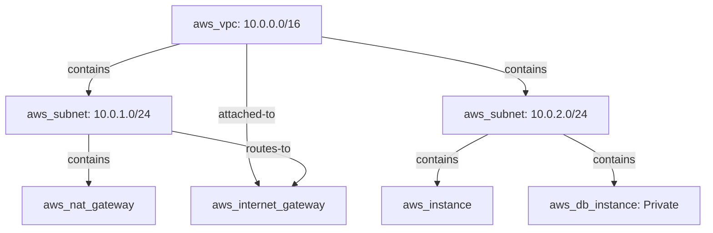

# CloudForge Architecture Analysis & Graph Verification

## Structural & Graph Integrity

The Architecture Validation Engine parses nodes and edges using topological algorithms to verify the physical realities of AWS cloud infrastructure.

### Mathematical CIDR Verification
Subnets are mathematically evaluated against parent VPC CIDR blocks:
1. Parse CIDR into 32-bit unsigned integers for network and broadcast boundaries.
2. Confirm Subnet prefix >= VPC prefix.
3. Assert that `subnet.network >= vpc.network` and `subnet.broadcast <= vpc.broadcast`.
4. Run pairwise intersection check across all subnets associated with the same VPC to prevent conflicting overlapping IP blocks.

### Public vs. Private Subnet Classification
In CloudForge, a subnet is never classified as "public" simply because the string name contains "public". A subnet is verified as public only when:
1. It is attached to a Route Table that routes `0.0.0.0/0` to an Internet Gateway (`aws_internet_gateway`), OR
2. It has an active route/connection leading to an attached Internet Gateway.
Resources like NAT Gateways that require public IPs and outbound internet routing are checked against this verified topology.
