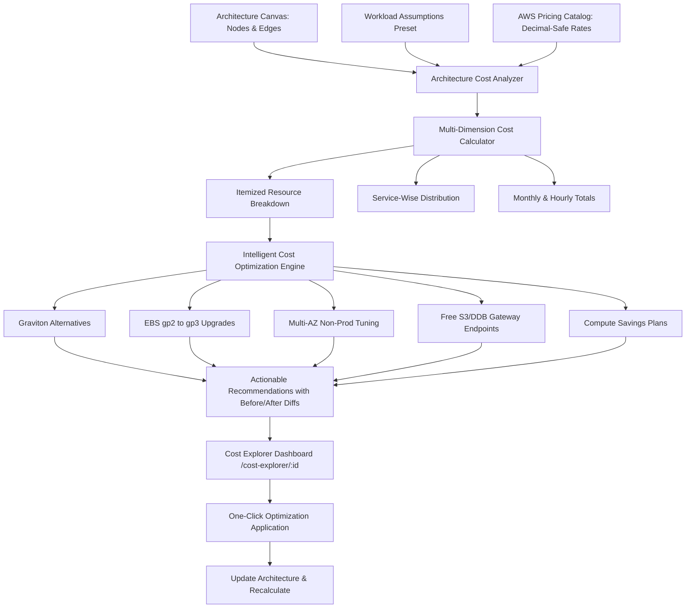

# CloudForge Cost Estimation & Optimization Engine Architecture

## Overview
Phase 08 establishes the financial intelligence layer of CloudForge. It integrates official AWS pricing datasets, regional cost factors, user-configurable workload assumptions, and an intelligent recommendation engine that guides users toward cost-efficient, high-performance architecture designs.

## Core Tenets
1. **Never Invent Prices**: All calculations derive from documented AWS Price List specifications. When a rate cannot be matched, it is clearly flagged as unavailable rather than fabricated.
2. **Transparent Workload Assumptions**: Infrastructure configurations alone do not dictate cost. A compute instance requires running hours; an S3 bucket requires storage volume. The Workload Assumptions System makes all usage expectations transparent.
3. **No Automatic Destructive Changes**: Recommendations require explicit user consent and provide clear diffs of before/after configurations before applying.
