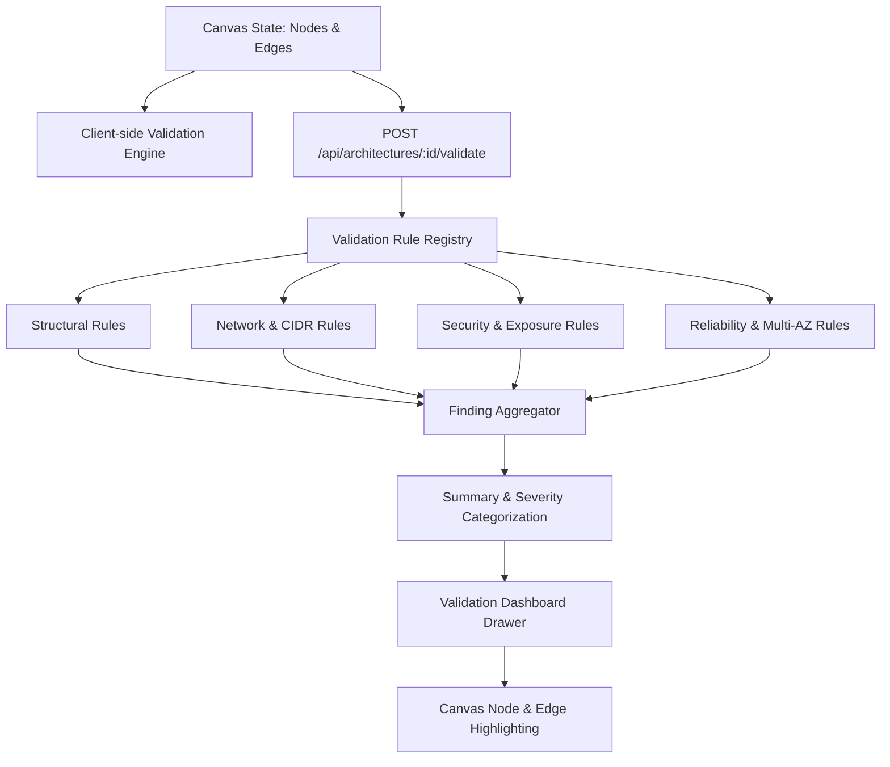

# CloudForge Validation Engine Architecture

## Overview
The CloudForge Architecture Validation Engine (Phase 07) is an extensible, metadata-driven intelligence engine that inspects cloud infrastructure topologies in real time. It evaluates structural relationships, networking parameters, security vulnerabilities, compute configurations, database topologies, and reliability standards against AWS Well-Architected Framework guidelines.

## Result Semantics & Status
The validation engine distinguishes between verified validity, detected problems, and unconfigured fields:
- **`VALID`**: All evaluated rules passed without errors or high-severity warnings.
- **`INVALID`**: One or more `CRITICAL` or `HIGH` severity findings were detected that would cause provisioning failures or severe security risks.
- **`UNKNOWN`**: Crucial fields are incomplete (e.g. unconfigured CIDR blocks). *Unknown is treated as missing configuration rather than an unproven vulnerability.*

## Severity Classification
| Severity | Description | Action Required |
|---|---|---|
| **`CRITICAL`** | Direct security exposure, invalid IP overlaps, or orphaned essential dependencies | Immediate resolution required before deployment |
| **`HIGH`** | Single point of failure, unattached gateways, unencrypted sensitive resources | High priority resolution |
| **`MEDIUM`** | Suboptimal reliability, Single-AZ databases, missing optional configurations | Recommended resolution |
| **`LOW` / `INFO`** | Architecture best practices and informational notices | Optional optimization |
